### hey, I'm Adam 👋

Second-year computer science student (BUT Informatique, data track) at IUT Toulouse.
I build things for **real users**, especially for a niche of people who think like me.
I want to truly understand what I build and get good at it: someone who can take on hard problems that keep the brain busy.

🎯 **Open to a work-study position (alternance)** in development, data or databases from **February 2027**,
in or around Toulouse.

&nbsp;&nbsp;&nbsp;

### what I've built

<table>
<tr>
<td width="50%" valign="top">

**[MusicMax](https://github.com/Allouche-Adam/MusicMax)** 
Lyrics for the songs Spotify Web is missing: synced, karaoke, translations. Chrome & Firefox.

</td>
<td width="50%" valign="top">

**[Effortcam](https://github.com/Allouche-Adam/EffortCam)** 
Proof of effort: a timelapse screen recorder + focus timer for Windows. Ends every session with a video of how long you really worked.

</td>
</tr>
<tr>
<td width="50%" valign="top">

**[MeetTogether](https://chromewebstore.google.com/detail/dclibfnmfmaiholhdilomkgdadganfmo)** · [website](https://meettogether.vercel.app) 
Video chat with strangers on ome.tv & umingle, together with up to 5 friends on one shared camera. Friends join from a link.

</td>
<td width="50%" valign="top">

**[Pair Narrator](https://github.com/Allouche-Adam/pair-narrator)** 
A Claude Code plugin that talks you through what the AI is building, and why. Out loud, if you want. Made for learners.

</td>
</tr>
<tr>
<td width="50%" valign="top">

**[Épure](https://github.com/Allouche-Adam/Epure)** · [live](https://epure-cleaner.vercel.app) 
Cleans your browser's password export (duplicates, weak and reused passwords) without sending it anywhere.

</td>
<td width="50%" valign="top">

**[ASCII Lab](https://ascii-lab-adam.vercel.app)** · [code](https://github.com/Allouche-Adam/ascii-lab) 
Turn pictures, GIFs, videos or your webcam into colored, animated ASCII art. Free, runs in your browser. Save as PNG, animated SVG or video.

</td>
</tr>
</table>


### what I use

**data:** `SQL` `PL/SQL` `PostgreSQL` `Oracle APEX` `Python` 
**dev:** `Java` `JavaScript` `TypeScript` `Next.js` `Node.js` `Supabase` `WebRTC` `Playwright` 
**tools:** `Git` `Vercel` `Claude Code`

### right now

- 🧪 building **SkillSwiper**: helps anyone (not just developers) find and install AI tools through short videos and plain-language search
- 📚 writing down every decision, so I understand my own code


### pick a world

<b>🌊 ocean</b>


<b>🔮 spirit</b>


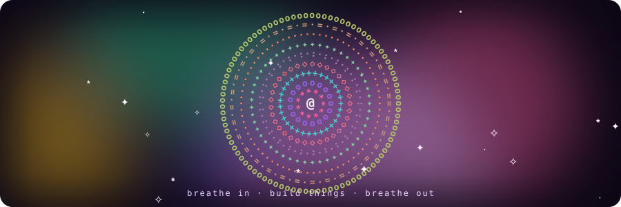

<b>🌳 meadow</b>

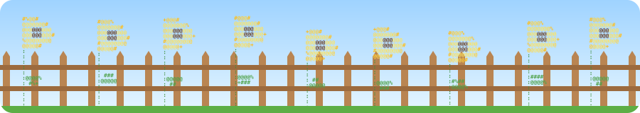

<b>🌙 midnight</b>

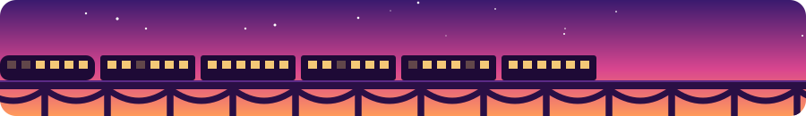

### want a README like this?

- 🎨 **Turn any picture, GIF or video into ASCII art** with **[ASCII Lab](https://ascii-lab-adam.vercel.app)** (free, [code here](https://github.com/Allouche-Adam/ascii-lab)). Press Download → *Animated image (SVG)*, put the file in your repo, and show it with ``: it keeps moving on GitHub.
- 🌊 **Want the scenes on this page?** They're generated by code in [`tools/`](tools/): fork [this repo](https://github.com/Allouche-Adam/Allouche-Adam), change the name in `tools/lib.mjs`, then run `npm install`, `npm run build` and `npm run readmes`.

If you make one, I'd love to see it ✨

every picture on this page is code: text characters and shapes, animated. <a href="tools/">here's how</a>.

